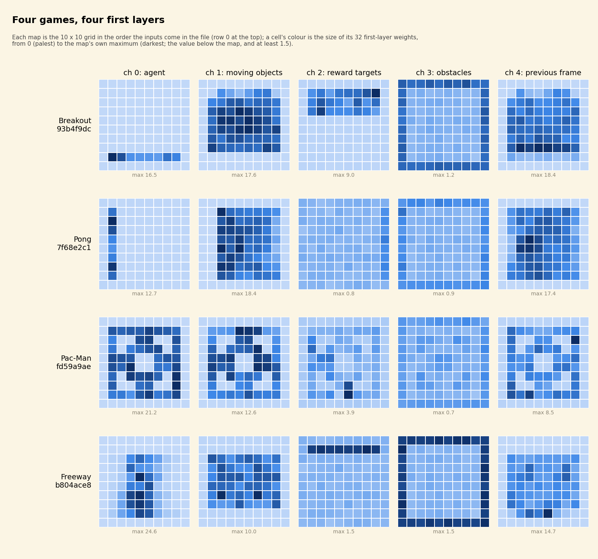
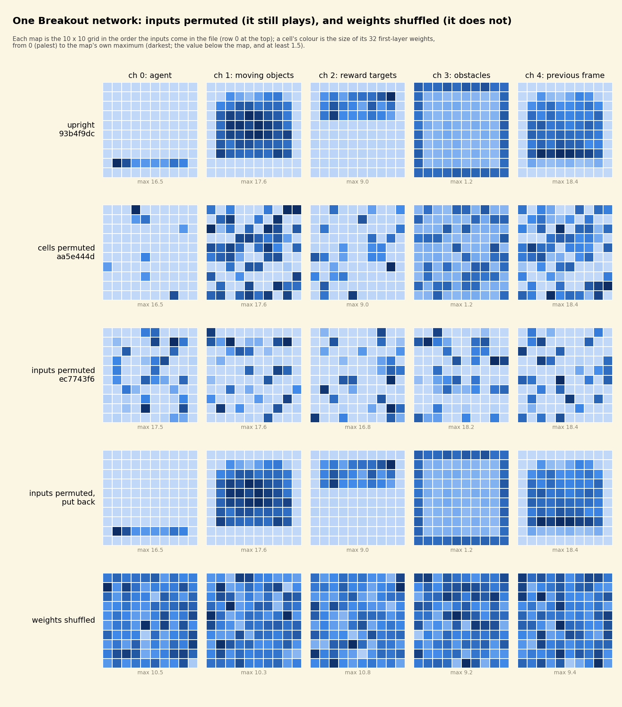
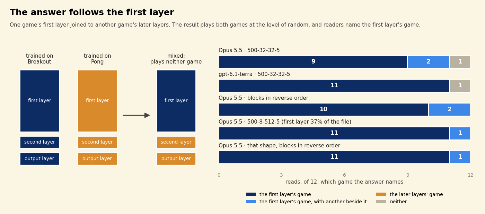
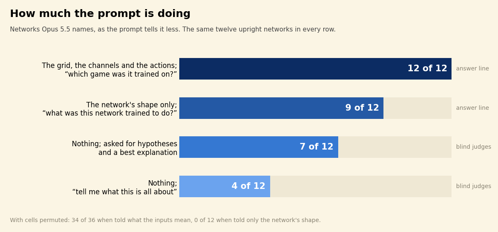
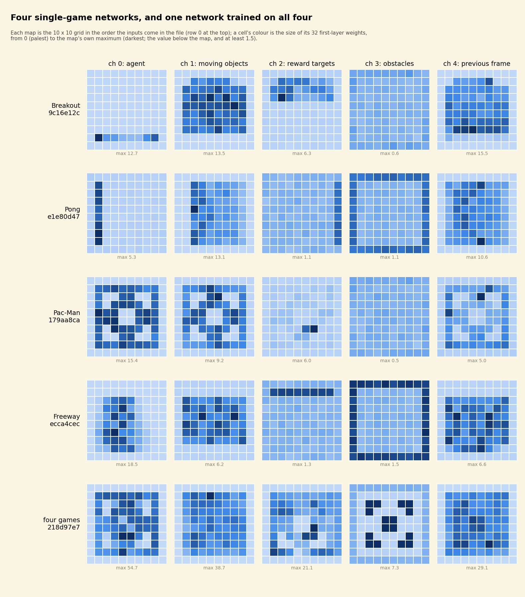

# Turning weight-space programming on its head

*What is a language model reading when it names a small network from its weights?*

**Rajesh R. Patel** · Independent Research · November 22, 2026

This repository is the write-up, the data and the code.

A language model is given the 17,253 weights of a small network that plays a grid game, as text, with no tools,
and asked which game. Takehi, Teoh, Zhang and Khattab showed that strong models can answer
([*Sparks of Weight-Space Programming*](#sources)). The Alan Turing Institute's replication concluded that
"reading weights is mostly reading the input layer" ([arXiv:2611.21449](#sources)). We agree, and this work
tests what that means with controls the earlier work did not run:

1. **The picture is not needed.** We reorder a network's inputs so that it plays exactly as before but its
   first layer no longer looks like a board. The strongest model from each of two providers still names every
   network. Weaker models fall to chance.
2. **The answer follows the first layer, and no reader concluded the layers did not belong together.** Put one
   game's first layer on another game's later layers and readers name the first layer's game in 62 of 64
   reads. Those networks play nothing. Some replies report later layers that do not fit and explain them away.
3. **The description does much of the work.** As the prompt says less about what the inputs mean, the same
   reader on the same networks goes from 12 of 12 to 4 of 12, and from 34 of 36 to 0 of 12 on reordered
   networks.
4. **A network trained on four games is read as one game with several levels,** until the reader is told
   there may be more than one.

## Setup

**Networks.** Four games on a 10 x 10 grid with five binary channels per cell (Breakout, Pong, Pac-Man,
Freeway), rebuilt from the description and recordings published with the original experiment. Each network is
500 inputs, two hidden layers of 32 tanh units, and 5 outputs, trained with PPO for 200 million steps. Three
seeds per game: twelve networks.

**Readers.** GPT-6 Astra, Fable 5.2, Opus 5.5 and Sonnet 5.5 at high effort; GPT-6.1 Terra and Haiku 5.5 at
extra high. These are not one common level: each reader is at the level stated. Fable, Opus and Sonnet were
read through Claude Code in a sealed container with every tool switched off; Astra, Terra and Haiku through
the API with no tools declared. One read per network unless a count is out of 36.

**Prompt.** The original experiment's, word for word (`prompts/mitfull.txt`): it describes the grid, the
channels and the actions and asks which game. Where a change to the network makes a sentence about input order
false, that sentence is replaced by one saying the order is not given (`prompts/mitunordered.txt`).

**Scoring.** An answer is scored by the first game it names on its answer line; Frogger counts as Freeway, as
in the original. Predictions were written down before each test and the outcomes recorded against them,
including the ones that failed (`scoring/preregistration_2026-11-20_haiku_effort.md`).

## 1. The picture is not needed

Drawn on the board, a trained network's first layer looks like its game. That is the picture a person reads,
and it is what the earlier work's heat maps show.

A fully connected layer does not care about the order of its inputs. Move the rows of the first weight matrix
and feed the board in the matching order, and the network computes exactly what it did. So the picture can be
removed while the network is left whole. Each changed network here was checked against its source: the same
outputs on 512 boards and the same score over 1,280 games.

| Term | What is done | The network afterwards |
|---|---|---|
| Board turned | the board is turned 90° or 180°; the actions keep their directions on the screen | plays identically |
| Cells permuted | the 100 cells are put in a shuffled order; each cell's five channels stay together | plays identically |
| Inputs permuted | all 500 inputs are put in a shuffled order | plays identically |
| Weights shuffled | each weight is moved within its matrix: the control used in the original experiment | destroyed |

Permuting inputs and shuffling weights look alike in a heat map and are opposite in kind. The earlier control
shuffles weights; readers fall to chance, which shows they use the weights. It cannot show whether they need
the picture, because it destroys the network along with it. Our own reads of that control are in a separate
table below.

Networks named, of those read:

| What is done to the inputs | gpt-6-astra, high | Fable 5.2, high | Opus 5.5, high | gpt-6.1-terra, extra high | Sonnet 5.5, high | Haiku 5.5, extra high |
|---|---|---|---|---|---|---|
| Nothing | 12 of 12 | 12 of 12 | 12 of 12 | 12 of 12 | 11 of 12 | 9 of 11 |
| Board turned 180° | 12 of 12 | 12 of 12 | 12 of 12 | 12 of 12 | 9 of 12 | 10 of 11 |
| Board turned 90° | 12 of 12 | 11 of 12\* | 12 of 12 | 12 of 12 | 9 of 12 | 6 of 11 |
| Cells permuted | 12 of 12 | 12 of 12 | 34 of 36 | 11 of 12 | 19 of 36 | 3 of 12 |
| All 500 inputs permuted | 12 of 12 | 12 of 12 | 24 of 36 | 8 of 12 | 9 of 12 | 2 of 12 |

\* The one miss is a Pong network. The answer did name Pong, but second: "Breakout — a simplified
paddle-and-ball version with a permanent target/brick row along the top (close to single-player wall Pong)".

- **Astra and Fable name every network with all 500 inputs permuted.** Opus and Terra name two in three.
  Haiku is at the level of guessing as soon as the cells move.
- **The readers say how.** They sort the 500 input rows by how each was trained. Opus, on a Breakout network
  with its inputs permuted: "The inputs are shuffled. No index-to-cell rule fits. [...] So I grouped the 500
  rows by how they behave instead." Then: "36 rows look exactly like the bias vector b1. [...] An input that
  is always 1 gets the same gradient as the bias. Exactly 36 such rows matches the 36 border cells". Astra,
  independently: "About 36 rows share a common weight shift, consistent with the 36 always-on border cells.
  [...] Constant-one inputs receive the same gradient as the bias."
- **What is read is a set of training-related signatures in each input's weights, not the layout.** The
  Turing note describes the mechanism: "an input cell that was never active gets no gradient and keeps its
  small initial weights, so each map is close to a record of where that channel's objects appeared"
  (arXiv:2611.21449). Two cases are close to exact: an input that was never on keeps its starting weights, and
  one that was always on moves with the bias. Between those, a row's size depends on how often the input was
  on and also on how much it mattered, so it is a signature of training and not a count.
- **The readers do not need the inputs in board order. They may still infer spatial properties indirectly
  from the unordered weight vectors:** 36 always-on rows is the border ring, and eight strong agent rows is
  one row of the board.
- **Where it runs out is where two games differ mainly in layout.** With inputs permuted, Opus calls Pong
  "Freeway" in most reads. With the board turned 90°, Pong becomes a paddle along the bottom row; Fable and
  Opus call it "Breakout without bricks", and Sonnet and Haiku miss it.

### On destroyed networks

With the weights shuffled there is no game to name, so this is not game identification and is scored
differently. Blind judges put each reply in one of three classes. The first two count as recognising that the
weights do not identify a game.

| Reader | Declines to name a game | Names one, and says the weights do not support it | Names one without saying so | Recognises it |
|---|---|---|---|---|
| gpt-6-astra, high | 11 | 1 | 0 | 12 of 12 |
| gpt-6.1-terra, extra high | 8 | 4 | 0 | 12 of 12 |
| Fable 5.2, high | 0 | 11 | 1 | 11 of 12 |
| Opus 5.5, high | 0 | 4 | 8 | 4 of 12 |
| Haiku 5.5, extra high | 0 | 3 | 8 | 3 of 11 |
| Sonnet 5.5, high | 0 | 2 | 10 | 2 of 12 |

Astra and Terra decline to answer. Fable answers and says "W1 has been scrambled or noised with respect to
position, so I cannot say where any channel matters". Opus, Sonnet and Haiku mostly name a game anyway.

## 2. The answer follows the first layer

A mixed network has one game's first layer (the 500 x 32 input weights and their biases) on another game's
later layers, with every number copied unchanged. Every mixed network scores at the level of random play at
both of its games. So does one seed's first layer on another seed's later layers within the same game (24 of
24 pairings): a first layer only works with the later layers it was trained beside.

| Reader | Reads | Names the first layer's game | Names the later layers' game | Concludes the layers do not belong together |
|---|---|---|---|---|
| Opus 5.5 | 48 | 47 | 0 | 0 |
| gpt-6.1-terra | 12 | 11 | 0 | 0 |
| Fable 5.2 | 4 | 4 | 0 | 0 |

- **It is not position or bulk.** Opus's 48 reads cover the file's blocks in the usual and the reverse order,
  and a second network shape (500-8-512-5) in which the first layer is 37% of the numbers and not 93%. The
  answer followed the first layer in every version.
- **The later layers are seen and overruled.** Opus, naming Breakout for Breakout's first layer on Pong's later
  layers: "W3 shows strong up/down swings [...] Up and down cannot move a bottom-row agent, so these logits
  just drift relative to no-op." That network scores 0.6 at Breakout, against 22.8 for the real one. A
  separate reading of Opus's replies found this pattern, an accurate report of the later layers followed by a
  reason they do not matter, in 6 of 12.
- **Prompts that presuppose nothing do not change it.** Under an open prompt ("tell me what this is all
  about"), a prompt asking for hypotheses, and a weights-only prompt, Opus, Terra and Fable (32 reads, one per
  file) named the first layer's game wherever they named one, and none said the parts do not belong together.

Readers check that a first layer looks like the product of training, as the table of destroyed networks shows. They
do not check that the layers compute anything together.

## 3. How much the prompt is doing

Opus 5.5 on the twelve unchanged networks:

| What the reader is told | Named | Scored by |
|---|---|---|
| Grid, channels, actions; "which game" (`mitfull`) | 12 of 12 | answer line |
| The network's shape only; "what was this network trained to do" (`parkweights`) | 9 of 12 | answer line |
| Nothing; asked for hypotheses and a best explanation (`hypotheses2`) | 7 of 12 | blind judges |
| Nothing; "tell me what this is all about" (`open2`) | 4 of 12 | blind judges |

With cells permuted, Opus names 34 of 36 when told what the inputs mean and 0 of 12 under the weights-only
prompt. It still recovers a 10 x 10 grid with five channels per cell and a border of walls, and never reaches
a game. The training trace can be read in any order only by a reader who knows what the inputs are. Without
that, the layout is doing real work.

## 4. A network trained on four games

*The top four rows here are single-game networks trained for a billion steps, to match the four-game network
below them.*

One network trained on all four games at once plays each at about a single-game network's level. Opus 5.5,
three reads each of three such networks:

| What the reader is told | Says more than one layout | Says more than one game |
|---|---|---|
| Nothing (`open2`; blind judges) | 9 of 9 | 0 of 9 |
| Nothing, asked for hypotheses (`hypotheses2`; blind judges) | 9 of 9 | 0 of 9 |
| The board, and "one or more games" (`mitgames`) | not asked | 9 of 9 |

Unprompted, every reply reports "two map layouts" or similar, which are Pac-Man's maze and Pong's far wall,
and takes them for levels of one game. Told there may be several games, it names Pac-Man in 9 of 9 and a
second game in 9 of 9, and never all four. Single-game networks under the same prompt were each named as
exactly one game.

## Limits

- Most cells are one read per network: three networks per game, four games.
- Sections 3 and 4 are Opus 5.5 only. Astra, Sonnet and Haiku have not read a mixed network.
- The readers are at different effort levels and came by two routes. Reads through Claude Code carry its
  system prompt around ours; each transcript shows it.
- The turned and permuted networks are made by moving weights, not by training on the changed board.
- Even at 37%, the first layer is a third of the file. Nothing here tests a case where it is a sliver.
- On the destroyed networks the prompt's answer format asks for a game and offers no way to decline. Whether
  the readers that named one would decline if invited is not tested.
- The provider's safety filter refused 25 of Haiku 5.5's 123 API reads. Those reads, reads cut off at the
  output limit, and reads Claude Code continued after the limit are kept, flagged, and not counted. No
  fallback model was used.
- The filter also refused all 21 reads of a first wording of the hypotheses prompt. They returned nothing and
  are not included.
- Not tested: a model writing or repairing weights, and readers with tools.

## What is here

| Folder | Contents |
|---|---|
| `weights/` | The networks that were read, one text file each, named by a random id. Numbers only. |
| `prompts/` | The wording of every prompt. A prompt as sent is the wording, a blank line, and a weights file. |
| `reads/` | Every read: `reply.txt`, `record.json` (model, effort, times, token counts, stop reason, hashes), the provider's own record of the exchange (`response.json` for an API read, `transcript.jsonl` for a read through Claude Code), and `marks.json` where a blind judge marked it. |
| `answer_key/` | What each id is, and the judges' fact sheets. **Kept apart on purpose.** |
| `scoring/` | The predictions and outcomes, the results tables, the rubric, and the judges' reports. |
| `figures/` | The figures above, and others. |
| `code/` | The games, the training code, and the programs that made the reads, the changed networks, the tables and the figures, as they were run. It is a record of what was run, not a package. |

**To run the test yourself, give your reader a file from `weights/` and a prompt from `prompts/`, and nothing
else.** The replies in `reads/` name the games, and `answer_key/` says what each file is.

Names in the files differ from the terms above in two places: "cells scrambled" and "inputs shuffled" in the
repository are "cells permuted" and "inputs permuted" here. `scoring/results.md` has every row, including
tests this page leaves out: the effect of effort (`scoring/haiku_effort_study.md`), networks trained for a
billion steps, a second network shape, and other models.

## Licence

The code and the write-up are under the MIT License (`LICENSE`). `NOTICE.md` lists what is other people's
work: the training algorithm is PureJaxRL's (Apache License 2.0); the original experiment's prompt and its four
networks are used under CC BY 4.0; and Juho Park's prompt and the quoted passages belong to their authors and
are included with credit.

## Sources

- Takehi, Teoh, Zhang and Khattab, *Sparks of Weight-Space Programming*, MIT CSAIL, November 2026: the
  original experiment. Its prompt is `prompts/mitfull.txt`, and its four published networks are among the
  files in `weights/`.
- Goworek, Hickey, Nanni and O'Reilly, *Replicating and Extending Weight-Space Programming: Frontier LLMs
  Compile Programs into Weights and Read Input Layers*, arXiv:2611.21449, November 2026: the finding that
  reading weights is mostly reading the input layer, and the heat maps.
- `prompts/parkweights.txt` is Juho Park's weights-only preamble, from his own reproduction.
