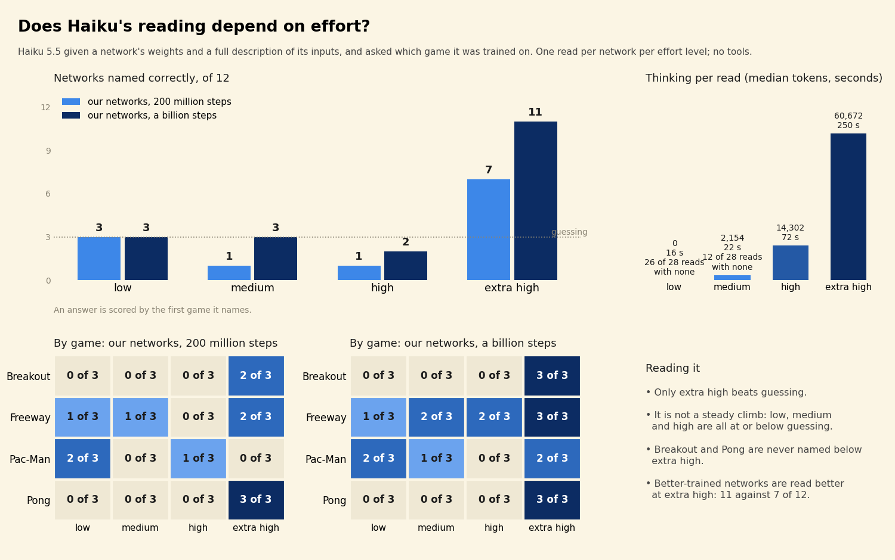

# The Haiku effort study

*Is naming the game a matter of how hard the model thinks?*

## The question

MIT's prompt gives the reader a full description of a network's inputs (the 10 by 10 grid, the five channels,
the five actions) followed by its weights, and asks which game it was trained on. A large model answers this
almost perfectly. Haiku 5.5 is the smallest current Claude model. Does it get there if it is given more effort?

## What was run

| | |
|---|---|
| Reader | Haiku 5.5, through Claude Code in a sealed container, no tools |
| Prompt | the MIT prompt, word for word |
| Effort | low, medium, high, extra high |
| Networks | ours at 200 million steps (12), ours at a billion steps (12), the original experiment's own (4) |
| Reads | one per network per effort level: 112 |
| Scoring | the reply's `Game:` line, by the first game it names |

The predictions were written down before the reads. The rule written down then was stricter: an answer that
named the right game and also mentioned another of the four did not count. The strict counts are in
`scoring/results.md`.

## What happened

**Networks named correctly, of 12:**

| Networks | Low | Medium | High | Extra high |
|---|---|---|---|---|
| Ours, 200 million steps | 3 | 1 | 1 | 7 |
| Ours, a billion steps | 3 | 3 | 2 | 11 |
| The original's four networks | 1 of 4 | 1 of 4 | 1 of 4 | 4 of 4 |

Guessing among four games would give about 3 of 12.

**How much thinking each level bought** (median per read):

| | Low | Medium | High | Extra high |
|---|---|---|---|---|
| Thinking tokens | 0 | 2,154 | 14,302 | 60,672 |
| Seconds | 16 | 22 | 72 | 250 |
| Reads with no thinking at all | 26 of 28 | 12 of 28 | 0 | 0 |

**By game, extra high only:**

| Networks | Breakout | Freeway | Pac-Man | Pong |
|---|---|---|---|---|
| Ours, 200 million steps | 2 of 3 | 2 of 3 | 0 of 3 | 3 of 3 |
| Ours, a billion steps | 3 of 3 | 3 of 3 | 2 of 3 | 3 of 3 |

Below extra high, Breakout and Pong are not named once, on either set.

**What Haiku answered, against the true game** (our 24 networks, all four effort levels, 96 reads; "several of
the four" are answers naming more than one, some of which count above by their first game):

| True game | Breakout | Pong | Pac-Man | Freeway | Several of the four | Another MinAtar game | No game named |
|---|---|---|---|---|---|---|---|
| Breakout | **5** | 0 | 4 | 3 | 4 | 1 | 7 |
| Pong | 0 | **2** | 3 | 8 | 8 | 0 | 3 |
| Pac-Man | 0 | 0 | **5** | 10 | 5 | 2 | 2 |
| Freeway | 0 | 0 | 3 | **11** | 7 | 0 | 3 |

## What it shows

1. **Only extra high beats guessing.** Low, medium and high are all at or below 3 of 12; extra high is 7 and 11.
2. **It is a threshold, not a slope.** Fourteen thousand thinking tokens at high do no better than none at
   low. Sixty thousand at extra high do.
3. **Low effort is a glance.** In 26 of 28 low-effort reads Haiku did no thinking at all, and its few correct
   answers there are lines that open with "Unknown" and then mention the right game as a guess.
4. **Freeway is Haiku's default.** "Freeway" or "Frogger" was the answer for 10 Pac-Man reads and 8 Pong reads.
   Any count that credits Freeway is partly crediting the habit.
5. **Better-trained networks are easier to read:** 11 against 7 of 12 at extra high. Opus showed no such
   difference (12 of 12 on both).
6. **It is not thinking time alone.** Opus at medium effort, with about 6,000 thinking tokens, named 21 of 24
   of these networks. Haiku needs ten times that to name 18 of 24.

## Against the predictions

The predictions were tested by the stricter rule they were written with.

| Prediction, made before the reads | Outcome |
|---|---|
| Identification depends on effort for Haiku | Held |
| Breakout and Pac-Man are named most, then Freeway, then Pong | Not supported: Freeway was named most; Pac-Man was 0 of 3 at extra high on the 200-million set |
| Better-trained networks are named more often | Held, at the threshold set |

## Limits

- One read per network per effort level, three networks per game.
- Scoring by the first game named counts a game offered as a low-confidence guess. That is most of the
  score at low effort.
- These reads went through Claude Code, which wraps its own system prompt around the prompt. Through the bare
  API at extra high Haiku scored 9 of 11 and 9 of 12 on the same two sets.

## Where the data is

- Counts: `scoring/results.md`, the `haiku-5.5` rows with prompt `mitfull`.
- Every `Game:` line and the full tables: `scoring/haiku_effort_report.txt`.
- Predictions and outcomes: `scoring/preregistration_2026-11-20_haiku_effort.md`, first and second tests.
- The reads: `readings/<blind id>/haiku-5.5_<effort>_container_mitfull_1`.
- This page's figure: `haiku_effort_figure.py`.
